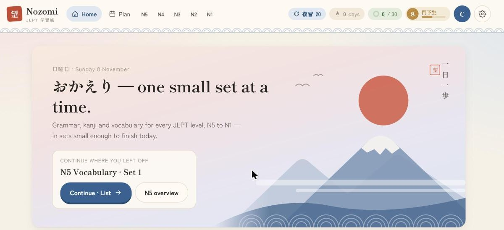

# Nozomi (望) · JLPT Study

**Live site: https://nozomi-jlpt.vercel.app**

A JLPT study website for every level from N5 to N1, built around one idea: *one small set at a time*. Instead of long word lists, you get short daily sets of grammar, kanji and vocabulary, and the site brings back what you are about to forget.



Built by two students of the same department at Kyoto University of Advanced Science.

## Features

- **N5–N1 content:** grammar, kanji and vocabulary split into small sets (10 grammar points, 15 kanji or 20 words per set)
- **Spaced-repetition reviews:** cards come back after 1, 3, 7, 14, 30, 60 and 120 days, with a little random jitter so reviews don't pile up on the same day
- **Reading and listening practice** with original passages and dialogues, voiced with natural Japanese voices (VOICEVOX) or the device's own voice
- **Mock tests** for each level in the JLPT question format, plus checking answers for the official JLPT practice workbooks
- **Exam plan:** set your exam date and get a daily target countdown
- **Accounts and sync:** sign in to keep progress across devices. Without an account, everything works offline in the browser.

## Tech

- Plain **HTML, CSS and JavaScript**: no framework and no build step, so pages load fast
- **Supabase** (PostgreSQL + Auth) for accounts and progress sync, protected by row-level security so each user can only read and write their own progress (`supabase/schema.sql`)
- **Vercel** for hosting
- Audio is pre-generated with VOICEVOX and packed into a few MP3 files with JSON offset indexes, so one download covers many phrases

```
index.html, level.html, study.html, deck.html, review.html,
reading.html, listening.html, test.html, plan.html, account.html
app.js        shared logic: progress, spaced repetition, audio, settings
cards.js      flashcard / study set UI
sync.js       Supabase sync
tap.js        tap-to-answer interactions
data/         study content per level (vocab, kanji, grammar, reading, listening, tests)
audio/        pre-recorded voice (p<N>.mp3 + i<N>.json offset indexes)
supabase/     database schema and security policies
```

## Run locally

It's a static site, so serve the folder with any web server:

```bash
npx serve .
```

To use your own Supabase project, run `supabase/schema.sql` in it and put the project URL and **publishable (anon)** key into `config.js`. The publishable key is meant to be public, and the row-level security policies keep each user's data private. Leave both empty for offline-only mode.

## Credits and data licenses

- Kanji: [KANJIDIC](https://www.edrdg.org/wiki/index.php/KANJIDIC_Project) (EDRDG, CC BY-SA 4.0), levelled by the official pre-2010 JLPT kanji lists
- Vocabulary lists: Jonathan Waller, [tanos.co.uk](http://www.tanos.co.uk/jlpt/) (CC BY)
- Voices: VOICEVOX:冥鳴ひまり, VOICEVOX:玄野武宏, VOICEVOX:No.7
- Listening, reading and mock tests are original practice material
- For the official JLPT workbooks only the answer keys are stored; the papers themselves load from [jlpt.jp](https://www.jlpt.jp)

Not affiliated with the Japan Foundation or JEES, which run the JLPT.
